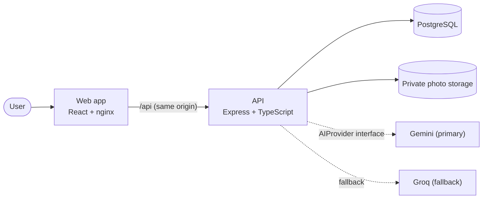

# PlantPulse – API

PlantPulse turns a photo of a houseplant into a living cartoon character. An AI vision model identifies the
plant and inspects its health, the domain rules decide the numbers (health score, care intervals), and the
character shows how the plant feels. If you forget to water it, you see it in its mood.

This repository contains the **backend**. The web app lives in its own repository:
[Plant_pulse_fronent](https://github.com/Jesusdavid2004/Plant_pulse_fronent).

- Backend repository: https://github.com/Jesusdavid2004/plant_pulse
- Frontend repository: https://github.com/Jesusdavid2004/Plant_pulse_fronent

## Architecture



The API follows a layered (clean) architecture. Dependencies only point inward:

```text
backend/src
├── presentation/http   routes, auth middleware, rate limits, error handler (thin: one use case per handler)
├── application         one class per use case (RegisterUserUseCase, RegisterPlantWithPhotoUseCase, ...)
│   └── ai              plant analysis schema (zod), versioned prompt, PlantPhotoAnalyzer
├── domain              business rules and interfaces: care catalog, health assessment, plant mood,
│                       pet traits, typed errors, repository and AIProvider ports
├── infrastructure      Prisma repositories, Gemini/Groq/Fake/Fallback/Caching AI providers,
│                       bcrypt + JWT, sharp image processing, local private image storage
├── shared              validated config (zod), logger (pino), constants
└── container.ts        composition root: the only place where concrete classes are wired
```

### How the AI is used

1. The user uploads a photo. The file is validated by **magic bytes**, EXIF metadata is stripped, and it is
   resized (`sharp`) before it is stored under a random name and sent to the model.
2. `PlantPhotoAnalyzer` sends the image to an `AIProvider` and asks for **structured JSON** that is validated
   with a zod schema. If validation fails it retries once with the validation error appended, then fails with a
   typed `AIResponseInvalidError`.
3. The model only **classifies what it sees** (species, care category, growth form such as rosette, upright, palm, tree, cactus or trailing, leaf shape, pattern and color, bloom shape and color, health condition and
   severity) and explains it in the active language. **Numbers and decisions come from domain rules**: the
   health score comes from `assessHealth`, the care intervals from `careCatalog`, the mood from
   `computePlantMood`.
4. Safety: the photo is treated as untrusted data (prompt-injection defense in the system prompt), requests have
   timeouts, retries with backoff, `maxOutputTokens`, a per-user daily quota and rate limits. Identical requests
   are cached by `sha256(prompt version + locale + image)`. Token usage and latency are logged, never raw content.
5. `FallbackAIProvider` tries Gemini first and Groq second. `FakeAIProvider` returns a deterministic plant and
   powers tests and local development without API keys.

## Quick start with Docker

Requirements: Docker. The compose file builds the API and the web app and starts its own PostgreSQL.

```bash
git clone https://github.com/Jesusdavid2004/plant_pulse.git
cd plant_pulse
git clone https://github.com/Jesusdavid2004/Plant_pulse_fronent.git frontend
cp .env.example .env          # optional: add GEMINI_API_KEY and AI_PROVIDER=gemini
docker compose up --build
```

Open http://localhost:5173. Without a Gemini key the app uses the deterministic fake AI (it always "finds" a
Monstera), so the whole flow can be tried offline. Change `FRONTEND_PORT`, `BACKEND_PORT` or `DB_PORT` in `.env`
if those ports are taken.

## Local development (without Docker for the API)

Requirements: Node.js 22 and a PostgreSQL database.

```bash
cd backend
cp .env.example .env           # set DATABASE_URL, JWT_SECRET and optionally GEMINI_API_KEY
npm ci --legacy-peer-deps
npx prisma migrate deploy      # creates the tables
npm run dev                    # http://localhost:3000, health check at /health
```

Try the AI with your key on any photo:

```bash
npm run ai:smoke -- ./some-plant.jpg es
```

## Environment variables

Defined and validated in `backend/src/shared/config.ts`. See `backend/.env.example` for a full template.

| Variable                                  | Purpose                                                          |
| ----------------------------------------- | ---------------------------------------------------------------- |
| `DATABASE_URL`                            | PostgreSQL connection string                                     |
| `JWT_SECRET`                              | Secret for access tokens (at least 32 characters)                |
| `CORS_ORIGIN`                             | Exact origin of the web app                                      |
| `COOKIE_SAME_SITE` / `COOKIE_SECURE`      | Refresh cookie policy (`none` needs HTTPS)                       |
| `TRUST_PROXY_HOPS`                        | Reverse proxies in front of the API (client IP for rate limits)  |
| `AI_PROVIDER` / `AI_FALLBACK_PROVIDER`    | `gemini`, `groq`, `fake` or `none`                               |
| `GEMINI_API_KEY` / `GEMINI_MODEL`         | Google AI Studio key and model (default `gemini-3.5-flash`)      |
| `GROQ_API_KEY` / `GROQ_MODEL`             | Groq key and vision model                                        |
| `AI_MAX_OUTPUT_TOKENS` / `AI_TIMEOUT_MS`  | Limits for each model call                                       |
| `AI_DAILY_QUOTA_PER_USER`                 | AI analyses allowed per user per day                             |
| `RATE_LIMIT_*`                            | Requests per window for auth, AI and general endpoints           |
| `MAX_FILE_SIZE` / `UPLOAD_DIR`            | Upload size limit and private photo directory                    |
| `APP_URL`                                 | Public URL of the web app, used for links inside emails          |
| `MAIL_TRANSPORT` / `MAIL_FROM`            | `smtp`, `file` (HTML previews in `MAIL_PREVIEW_DIR`) or `none`   |
| `SMTP_HOST` / `SMTP_PORT` / `SMTP_SECURE` | SMTP server for reminder emails                                  |
| `SMTP_USER` / `SMTP_PASSWORD`             | SMTP credentials                                                 |
| `REMINDERS_ENABLED`                       | Turns the neglect reminder job on or off                         |
| `REMINDER_CHECK_INTERVAL_MINUTES`         | How often the job looks for neglected plants (default 60)        |

Secrets live only in environment variables. Never commit a real `.env`.

## API

All responses use `{ success, data }`. Errors use `{ success: false, code, message_key, error, details? }`;
`message_key` is an i18n key that the frontend translates. The active language is read from `Accept-Language`.

| Method and path                  | Description                                              |
| -------------------------------- | -------------------------------------------------------- |
| `POST /api/auth/register`        | Create an account (returns access token, sets cookie)    |
| `POST /api/auth/login`           | Log in                                                   |
| `POST /api/auth/refresh`         | Rotate the refresh token (cookie + CSRF header)          |
| `POST /api/auth/logout`          | Revoke the refresh token                                 |
| `GET/DELETE /api/auth/me`        | Current user / hard delete of the account and its files  |
| `GET/POST /api/plants`           | List plants / register a plant from a photo (AI)         |
| `GET/PATCH/DELETE /api/plants/:id` | Read, rename or delete a plant                         |
| `POST /api/plants/:id/checkups`  | New photo health check-up (AI)                           |
| `GET /api/plants/:id/analyses`   | Health history                                           |
| `POST /api/plants/:id/care`      | Log WATER, SUN or FERTILIZE                              |
| `GET /api/plants/:id/mood`       | Mood of the character computed from care and health      |
| `GET /api/plants/:id/photos/:photoId` | Stream a photo (owner only)                         |
| `GET /api/plants/:id/pet`        | Level, experience, coins, scenes and pots of the character |
| `POST /api/plants/:id/games`     | Submit a mini-game score (rewards are computed server side) |
| `POST /api/plants/:id/pet/pots`  | Buy a pot with coins                                     |
| `PUT /api/plants/:id/pet/equipment` | Equip an unlocked scene or an owned pot               |
| `PATCH /api/auth/me/preferences` | Turn reminder emails on or off and set the email language |
| `POST /api/auth/me/test-email`   | Send a test email to the signed in user                  |
| `POST /api/auth/unsubscribe`     | One click unsubscribe with the signed token from an email |
| `GET /health`                    | Health check                                             |

### Interaction and reminders

- **Progress**: real care (water, sun, fertilizer) gives experience and coins, with a cooldown so spamming a
  button gives nothing. Levels unlock scenes (living room, garden, night sky, beach, greenhouse).
- **Mini-games**: catch the drops and memory match. The server clamps the score, computes the reward and caps the
  coins a plant can earn per day, so a forged score cannot farm rewards. Coins buy pots.
- **Reminders**: a job (`IntervalJob`) runs every `REMINDER_CHECK_INTERVAL_MINUTES`, finds users whose plants are
  sad or sick (domain rule `isNeglected`), and sends one localized digest email per user, at most once every 24 hours.
  Emails carry a signed one click unsubscribe link. Plant names are HTML-escaped. With `MAIL_TRANSPORT=file` the
  emails are saved as HTML files so you can preview them without an SMTP server.

## Security

Helmet headers, strict CORS to the frontend origin, short-lived JWT access tokens plus a rotating refresh token
in an `httpOnly` cookie (replay of an old refresh token revokes the whole session), bcrypt password hashing,
ownership checks inside every repository query, rate limits per IP and per user, magic-byte upload validation,
EXIF stripping, random file names, validated input everywhere (zod), Prisma parameterized queries and hard
deletion of the user's data and files.

## Scripts and tests

```bash
cd backend
npm run typecheck        # tsc, strict mode
npm run lint             # ESLint
npm run format:check     # Prettier
npm test                 # unit + integration tests (creates a <db>_test database automatically)
npm run test:coverage    # coverage of the domain and application layers
```

The integration tests run every main endpoint against a real PostgreSQL test database, with the fake AI
provider. GitHub Actions runs lint, type-check and tests on every push (`.github/workflows/ci.yml`).

## Deployment on Railway

The frontend nginx proxies `/api` to the backend, so the browser only talks to one origin and the refresh cookie
stays first-party.

1. **Database**: in a new Railway project add the **PostgreSQL** plugin.
2. **Backend service**: _New → GitHub repo_ `plant_pulse`, set **Root Directory** to `backend` (it uses
   `backend/Dockerfile` and `railway.json`). Add variables:
   `DATABASE_URL=${{Postgres.DATABASE_URL}}`, `JWT_SECRET=<random 32+ chars>`, `AI_PROVIDER=gemini`,
   `GEMINI_API_KEY=<your key>`, `CORS_ORIGIN=<frontend public URL>`, `TRUST_PROXY_HOPS=2`.
   Migrations run automatically on start. Attach a **Volume** mounted at `/app/uploads` so photos survive
   redeploys. Generate a public domain only if you need to reach the API directly.
3. **Frontend service**: _New → GitHub repo_ `Plant_pulse_fronent`. Add the variable
   `BACKEND_URL=https://<backend public or private URL>` (no trailing slash). Generate a public domain: that is the
   URL of the application.
4. Open the frontend URL, sign up, and add a plant with a photo.

> The `ai-service/` folder is the original Python prototype (rule engine and TensorFlow scaffolding). The current
> app does not call it: plant analysis runs through the `AIProvider` layer above.

## Resumen en español

PlantPulse convierte la foto de una planta en un personaje de dibujos animados que muestra cómo se siente. Una IA
con visión (Gemini, con Groq como respaldo) identifica la planta y revisa su salud; las **reglas del dominio**
calculan los números (puntaje de salud, frecuencia de riego, luz y abono) y el personaje cambia de ánimo según el
cuidado real que le das. Incluye registro e inicio de sesión (JWT + refresh rotativo), español e inglés,
tema claro y oscuro, límites de uso y cuota diaria de IA, subida segura de imágenes y borrado completo de la
cuenta.

- **Con Docker**: clona este repo y el del frontend (en `./frontend`), copia `.env.example` a `.env` y ejecuta
  `docker compose up --build`. Abre http://localhost:5173. Sin clave de Gemini usa una IA simulada.
- **Variables**: ver la tabla de arriba y `backend/.env.example`. Las claves van solo en variables de entorno.
- **Pruebas**: `npm test` dentro de `backend` (usa una base de datos de pruebas real).
- **Railway**: crea PostgreSQL, el servicio del backend (Root Directory `backend`) y el del frontend; define
  `BACKEND_URL` en el frontend y las variables del backend indicadas arriba.
- **Interacción**: el cuidado real da experiencia y monedas; los niveles desbloquean escenarios y las monedas
  compran macetas. Hay dos minijuegos (atrapa las gotas y memoria) cuyo puntaje valida el servidor.
- **Recordatorios por correo**: si una planta está triste o enferma, el usuario recibe un correo (en su idioma,
  máximo uno cada 24 horas) con enlace para darse de baja. Configura SMTP con las variables `SMTP_*` y
  `MAIL_TRANSPORT=smtp`; en desarrollo los correos se guardan como archivos HTML.
